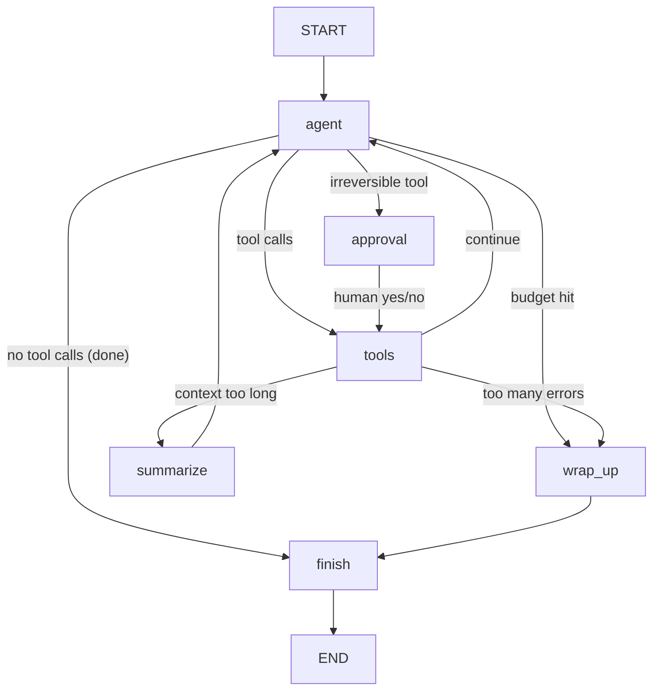
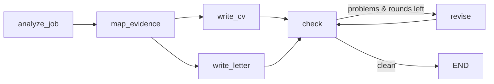

# Job Agent (LangGraph, free models)

An agent that finds real job openings, judges each one honestly against your CV, and drafts tailored,
fact-checked applications for the best few. **You submit.** It runs on free models: Groq's free cloud
tier, or Ollama fully on your own computer.

```
python -m jobagent run       →  searches feeds · scores jobs · drafts the top matches · writes a report
python -m jobagent trace     →  every model call and tool call it made, and why it stopped
python -m evals.run_evals    →  grades the agent on fixed test tasks
```

---

## 1. LangGraph in five minutes

An agent is a loop: **the model decides → tools act → the model looks at the results → repeat until done.**
You could write that as a `while` loop. LangGraph writes it as a **graph**, which buys you things a loop
makes painful: pausing for a human, resuming after a crash, capping the budget, branching to a summariser,
and a picture of exactly what can happen.

| Concept | What it is | In this project |
|---|---|---|
| **State** | A typed dict shared by every step. Each node returns *updates* to it, never the whole thing. | `state.py`: `AgentState` (messages, summary, step counters, approvals) |
| **Reducer** | A rule for merging an update into a field. `add_messages` appends new messages rather than replacing the list, and deletes on `RemoveMessage`. | `messages: Annotated[list, add_messages]` |
| **Node** | A plain Python function `state → update`. | `agent`, `tools`, `approval`, `summarize`, `wrap_up`, `finish` in `graph.py` |
| **Edge** | "After A, go to B." | `approval → tools`, `summarize → agent` |
| **Conditional edge** | A function that looks at the state and picks the next node. All the control logic lives here. | `after_agent`: tools, approval, wrap_up or finish? |
| **compile()** | Checks the graph and turns it into a runnable. | `g.compile(checkpointer=...)` |
| **Checkpointer** | Saves the state after every step, keyed by a `thread_id`. Gives you resume, time-travel debugging and pauses. | `SqliteSaver` → `data/checkpoints.db`; `jobagent resume <id>` |
| **interrupt() / Command(resume=)** | Pauses the graph inside a node and waits for a human. Resuming re-runs that node, and `interrupt()` returns the answer. | `approval` node, before any email is sent |
| **Subgraph** | A compiled graph used as one step of another graph. | `drafting.py`: write → fact-check → revise loop, called by the `draft_application` tool |
| **RetryPolicy** | Automatic retries with backoff on a node, e.g. for free-tier rate-limit errors. | on `agent`, `summarize`, `wrap_up` |
| **recursion_limit** | LangGraph's own hard stop on total steps: a last line of defence. | set from `max_steps` |

The graph (`python -m jobagent graph` prints it as Mermaid):



**Why not the prebuilt `create_agent`?** It's a fine one-liner for the plain loop. This agent needs custom
guardrails, approvals and memory, and seeing every node is the point of learning LangGraph, so the graph
is written out by hand (about 200 lines in `graph.py`).

**A LangGraph gotcha this code handles:** after `interrupt()`, LangGraph re-runs the *whole node* when it
resumes. So the approval node does nothing before `interrupt()`, and the actual email is sent later, in
`tools`. Put a side effect before `interrupt()` and it would happen twice.

---

## 2. How each part of a good agent is built here

### Instructions (system prompt): `prompts.py`
- **Role and goal:** an agent working *for* one candidate, with this run's task injected.
- **What success looks like:** a five-point "you're done when…" checklist, plus "finding nothing good is
  a valid outcome".
- **Scoring rubric** (1-5), **hard rules** (no invented jobs or skills, never send without approval),
  and **what to do when stuck** (read the error hint, try another source, score 3 when unsure, write the
  report when low on steps).
- **Final report format**, so the output can be parsed and compared between runs.
- The CV, preferences, configured searches and notes from earlier runs are templated in.

### Tools: `tools/`
Each tool does one thing, takes a Pydantic schema (validated before it runs), and has a description
written for a new teammate. Expected failures raise `ToolError` with a **hint**, and the model sees
`ERROR: Jooble needs an API key. Use another source.` rather than a stack trace.

| Tool | Does | Guard built in |
|---|---|---|
| `search_jobs(source, query, location, limit)` | queries one live feed, saves new jobs, returns compact rows | only enabled sources; de-dup; your filters applied; only *new* jobs shown |
| `get_job_details(job_id)` | full posting (truncated) | id must exist, so invented ids fail |
| `save_assessment(job_id, score, verdict, reasons, gaps, eligible_location)` | records the judgement | score 1-5; ineligible location **capped at 2** in code |
| `list_jobs(status, min_score, limit)` | queries the tracker | — |
| `draft_application(job_id, feedback)` | runs the tailoring subgraph (section 3): CV + letter + match report | needs score ≥ threshold; per-run draft cap; result is 1 line, not the drafts |
| `read_web_page(url)` | reads a link you gave it | respects robots.txt |
| `add_job_from_page(url, …)` | saves that job | only for pages actually read this run (no invented jobs) |
| `add_job_from_text(title, company, …)` | saves a job ad you pasted (e.g. topjobs.lk) | title + company must appear in your message |
| `write_note(note)` | lesson for future runs | ≤300 chars |
| `send_application_email(job_id, to, subject, body)` | emails the CV + letter | **human approval on every call**; without SMTP it saves a .eml |

### State and memory
- **Short-term:** `messages` in the graph state. Tool results are short by design (compact rows,
  truncated pages, a one-line draft result), so the context stays small.
- **Summarising:** past `max_context_messages`, the `summarize` node compresses old steps into
  `summary` and deletes them with `RemoveMessage`. It never splits a tool call from its result
  (`memory.split_point`), which most model APIs reject.
- **Long-term:** `data/jobs.db` tracks every job ever seen and its status, so nothing is re-read or
  re-scored. `data/notes.md` holds the agent's own lessons, and the latest 40 lines go into the next run's
  prompt. **Retrieval on demand:** full descriptions are fetched only with `get_job_details`.
- **Durable runs:** checkpoints in `data/checkpoints.db`. If a run dies, `jobagent resume <id>` carries on.

### Guardrails and stopping conditions: `graph.py` + `config.yaml → limits`
- `max_steps`, `max_tool_calls`, and `recursion_limit` as a backstop. When a limit is hit, `wrap_up` makes
  **one tool-less call** to write the report. A run always ends with a report, never silently.
- **Loop guard:** an identical tool + args call is blocked after `max_same_call` uses.
- **Error budget:** `max_consecutive_errors` in a row ends the run.
- **Input validation:** Pydantic on every tool. Invalid args → a readable `ERROR: invalid arguments…`.
- **Human confirmation** for irreversible tools (`approval_required` list) via `interrupt()`. A "no"
  returns `DECLINED` to the model, which is told not to retry.
- **Honesty enforced in code:** the location cap, assess-before-draft, the fact-check subgraph, and
  real-id checks don't rely on the model obeying the prompt.
- **Rate limits:** a token-bucket limiter (`requests_per_minute`) plus retries keep you inside the free tiers.

### Observability and evaluation
- `logs/<run_id>.jsonl` records every model call (step, latency, token usage, tool calls, text), every tool
  call (args, result, ms, error), every guard decision and approval, and why the run stopped.
  `python -m jobagent trace` shows it as a timeline.
- Optional visual traces: `export LANGSMITH_TRACING=true LANGSMITH_API_KEY=…` (free developer plan). No code change.
- **Evals** (`evals/tasks.yaml`): four fixed tasks on fixture feeds. They're graded on what actually
  happened (tracker rows, trace, files), not on what the agent says it did:
  `daily_triage`, `all_sources_down`, `assess_a_link`, `email_needs_approval`.
  Checks include: the right job scored ≥4 and drafted, tailoring quality (no invented numbers, contact kept, letter names the company, right length), the US-only job capped, no invented job ids, no
  invented skills in the CV, no unapproved email, finishes within N steps, no loops.
- **Unit tests** (`tests/`): 23 tests of the graph mechanics and every guardrail, using a scripted fake
  model. No LLM, no network, about 2 seconds.

```bash
python -m pytest -q                                   # after any code change
python -m evals.run_evals --repeat 3                  # after any prompt/tool/model change
python -m evals.run_evals --provider groq --model openai/gpt-oss-120b   # compare models
```

---

## 3. CV tailoring and cover letters

`draft_application` (inside the agent) and `python -m jobagent tailor <job_id>` (standalone) run a
LangGraph **subgraph** (`drafting.py`). It's built so that free models do it well and can't lie for you:



| Stage | What it does | Why |
|---|---|---|
| **analyze_job** | Pulls must-haves, nice-to-haves, 10-20 ATS keywords, responsibilities, a factual company hook and the tone out of the posting | tailoring needs to know what the employer screens for |
| **map_evidence** | For each requirement, finds **exact quotes from your CV** and rates it strong / partial / none. **Code then deletes any quote that isn't word-for-word in your CV** | the CV and letter can only build on verified evidence |
| **write_cv** | Rewrites your summary for this role, orders sections by relevance, puts matching bullets first, rephrases bullets in the employer's words *only where your CV already shows it* (CV "built APIs with FastAPI" + keyword "REST API" → "Built REST APIs with FastAPI"), lists job-relevant skills first. ATS-safe Markdown → Word | gets past keyword filters and the 6-second human skim |
| **write_letter** | 220-320 words: names the exact role and company plus one specific reason; two paragraphs each proving a top requirement with a real fact from your CV; at most one honest sentence on a gap; close. No clichés, no placeholders | specific beats generic, and recruiters spot templates |
| | CV and letter are written **in parallel** (fan-out/fan-in in LangGraph) | faster |
| **check** | **Code checks** (`factcheck.py`): numbers not in your CV, job terms like "AWS" appearing in the CV when your CV doesn't have them, dropped contact details, placeholders, clichés, missing company name, wrong length. Then an **LLM fact-checker** compares both drafts with your CV line by line and confirms or dismisses the code's findings | code catches what weak models miss; the model catches paraphrased invention |
| **revise** | Fixes only what was flagged, only in the document that has the problem; up to `revision_rounds` | doesn't churn good text |

Each job folder (`output/<date>/<score>-<company>-<title>-<id>/`) contains:

- `cv.md` / `cv.docx`: your tailored CV
- `cover_letter.md` / `cover_letter.docx`
- `fit.md`: **requirement-by-requirement match** (✅ / 🟡 / ❌ with the CV quote proving each), ATS keyword
  coverage before → after tailoring, and the posting's keywords missing from your CV. *If you really have
  any of them, add them to `profile/cv.md` and redraft.* The agent never adds them for you.
- `review.md`: fact-check result. If it says NEEDS YOUR ATTENTION, read it before sending
- `job.md`: the posting and the fit score

**Not happy with a draft? Redraft with feedback.** The old version moves to `previous/`:
```bash
python -m jobagent tailor 3fa9c2e1 --feedback "Shorter letter. Lead with the PostgreSQL tuning work. Formal tone."
```

Tips for the best results:
- **Put everything true in `profile/cv.md`:** every tool, project, number and responsibility. A long
  "master CV" is fine. Tailoring can only select and rephrase; it can't invent, by design.
- A separate stronger model for writing helps: `llm.draft_model` (e.g. `openai/gpt-oss-120b` on Groq, or
  `qwen3.6:27b` on Ollama), while the cheaper/faster model runs the search loop.
- Adjust letter length with `cover_letter_words: [220, 320]`.

---

## 4. Setup (free)

```bash
cd job-agent
python -m venv .venv && source .venv/bin/activate          # Windows: .venv\Scripts\activate
pip install -r requirements.txt
cp config.example.yaml config.yaml
cp profile/cv.example.md profile/cv.md                     # replace with your real CV
```

Pick a model in `config.yaml`:

| Option | Cost | Setup | Notes |
|---|---|---|---|
| **Groq** (default) | free tier, no card | key at console.groq.com → `export GROQ_API_KEY=…` | fast; per-minute/day caps, so keep `requests_per_minute` ≈ 20 |
| **Ollama** | free, unlimited | install ollama.com → `ollama pull qwen3:8b` | private, offline; needs ~8-16 GB RAM; slower |
| **Gemini** | free tier | key at aistudio.google.com → `export GOOGLE_API_KEY=…` | tight daily limits; free-tier data may be used by Google |

Then check that the model can call tools: `python -m jobagent check`. Small models often can't. If it
prints NONE, choose a bigger one.

## 5. Use it

```bash
python -m jobagent run                                     # daily search
python -m jobagent ask "Assess this job: https://..."      # one link
python -m jobagent ask "Find remote data engineering jobs open to Sri Lanka, assess the top 5"
python -m jobagent list                                    # tracker
python -m jobagent tailor 3fa9c2e1 --feedback "..."        # redraft CV + letter for one job
python -m jobagent status 3fa9c2e1 applied                 # after YOU submit
python -m jobagent export                                  # tracker.xlsx
python -m jobagent trace                                   # what happened in the last run
```

Drafts go to `output/<date>/<score>-<company>-<title>-<id>/` (see section 3). **Read `review.md` and the
drafts yourself before sending anything.**

**topjobs.lk:** its robots.txt blocks bots, so the agent won't read it. Copy the ad text into a task:
`python -m jobagent ask "Assess this job ad: <pasted text>"`.

**Every morning (cron):** `30 7 * * * cd /path/job-agent && .venv/bin/python -m jobagent run >> run.log 2>&1`
(Windows: Task Scheduler running `.venv\Scripts\python.exe -m jobagent run`, started in the project folder.)

---

## 6. Tools to add next (all free)

| Tool | Why | Free option |
|---|---|---|
| `research_company(name)` | check a company is real, its size, recent news, red flags | `ddgs` (DuckDuckGo search) package, or self-hosted SearXNG |
| `read_job_ad_image(path)` | topjobs.lk ads are images | a vision model: `ollama pull gemma4:e4b` or Gemini free tier |
| `check_inbox_replies()` | spot recruiter replies and interview invites, update statuses | Gmail IMAP with an App Password (read-only) |
| `schedule_follow_up(job_id, days)` | reminder to follow up 7-10 days after applying | write an `.ics` calendar file |
| `notify(message)` | send the daily report to your phone | Telegram bot API (free) |
| `prepare_interview(job_id)` | likely questions + your matching CV stories | another small subgraph, like drafting |
| `salary_context(title, country)` | sanity-check an offer | public salary pages via `read_web_page` |

Each new tool should follow the same pattern: a Pydantic input schema, a description written for a
teammate, `ToolError` with a hint, short output, and a line in `evals/tasks.yaml` that exercises it.
If it's irreversible, add it to `approval_required`.

**Don't add:** LinkedIn scraping or auto-apply bots. They break LinkedIn's terms, get accounts banned,
and recruiters' spam filters catch them.

---

## Project layout

```
jobagent/
  graph.py       the LangGraph: nodes, routing, guardrails, interrupt, checkpointer, run_agent()
  state.py       AgentState (+ reducers)
  prompts.py     system prompt, summariser, drafter, fact-checker
  tools/         one module per tool group; context.py holds shared deps + ToolError
  drafting.py    tailoring subgraph: analyse → evidence → CV ∥ letter → check → revise
  factcheck.py   code-based checks on drafts (invented numbers/skills, placeholders, length…)
  memory.py      notes.md + safe summarisation split
  store.py       SQLite tracker
  tracing.py     JSONL trace + viewer
  llm.py         free model factory (groq / ollama / gemini) + rate limiter
  sources/       job feeds (remotejobs, remotive, jooble, greenhouse, lever)
evals/           tasks.yaml, run_evals.py, fixtures/ (feeds, CV, web page)
tests/           scripted-model tests for every guardrail
```
